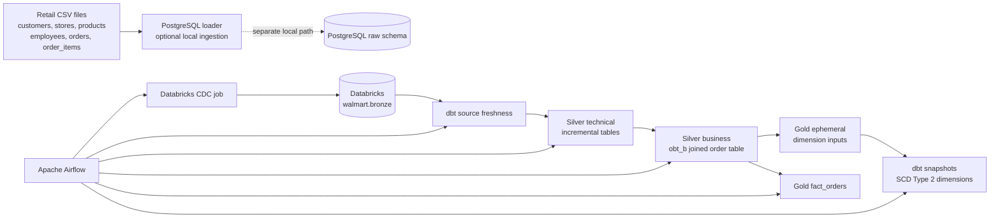

# Walmart Retail Data Platform

## Rajat Pundir

**Data Engineering | Analytics Engineering | AI/ML Systems**

Dehradun, India<br>
`+91-8923365987` | `rajatpundir07@gmail.com`<br>
[LinkedIn](https://linkedin.com/in/rajat-pundir-b7556b298) | [GitHub](https://github.com/Rajatpundir07) | [LeetCode](https://leetcode.com/rajatpundir07)

### Education

**Graphic Era Hill University, Dehradun**<br>
B.Tech - Computer Science with AI & Machine Learning Specialization<br>
Aug 2023 - Present | CGPA: **8.51 / 10.0**

---

## Project Overview

This repository implements a Walmart-style retail data platform that moves operational data through a layered analytics architecture. It combines local retail CSV data, PostgreSQL loading utilities, Databricks as the analytical source, dbt for transformation and historical modeling, and Apache Airflow for orchestration.

The design is intentionally close to a production data workflow:

- **Bronze/source**: operational entities such as customers, stores, products, employees, orders, and order items.
- **Silver technical layer**: incremental dbt tables that capture source changes using `updated_timestamp`.
- **Silver business layer**: a joined order business table (`obt_b`) that brings together the retail entities.
- **Gold layer**: ephemeral dimension inputs, snapshot-based slowly changing dimensions, and an order fact table.
- **Orchestration layer**: Airflow coordinates ingestion, freshness checks, transformations, tests, snapshots, and fact creation.

This is an analytics engineering project as much as an orchestration project: the key value is the contract between raw entities, incremental models, reusable joins, historical dimensions, and downstream facts.

## Architecture



### End-to-end execution order

The `orchestrate` DAG defines this dependency chain:

1. Trigger and poll a Databricks CDC job until it succeeds.
2. Remove the dbt `target` and `logs` directories for a clean run.
3. Check source freshness.
4. Build the `silver_t` incremental models.
5. Run tests for `silver_t`.
6. Build the `silver_b` business layer.
7. Run tests for `silver_b`.
8. Build the gold ephemeral models.
9. Run dbt snapshots for historical dimensions.
10. Build the gold order fact.

## Data Model

### Source entities

The project models six retail entities:

| Entity | Business purpose | Key |
| --- | --- | --- |
| `customers` | Customer identity and geography | `customer_id` |
| `stores` | Store master data and location | `store_id` |
| `products` | Product, category, brand, and price | `product_id` |
| `employees` | Store workforce and compensation | `employee_id` |
| `orders` | Order header, customer, store, status, and value | `order_id` |
| `order_items` | Product-level order lines and quantities | `order_item_id` |

The local dataset is stored in [`walmart_dataset/data`](walmart_dataset/data). The DDL for the PostgreSQL representation is in [`walmart_dataset/ddl/walmart_schema.sql`](walmart_dataset/ddl/walmart_schema.sql).

### Silver technical layer

The six `silver_t` models are incremental tables. Each model:

- Reads from a declared Databricks source.
- Uses its entity key as the dbt `unique_key`.
- Adds a `processed_at` audit timestamp.
- On incremental runs, filters rows where `updated_timestamp` is newer than the latest processed value.

The model contracts and tests currently cover non-null and uniqueness behavior for product and order keys. This keeps the technical layer efficient while preserving a clear change-data boundary.

### Silver business layer

`obt_b` creates the reusable order business table by left joining:

```text
orders
	-> customers
	-> order_items
	-> products
	-> employees
	-> stores
```

It standardizes column names with entity-specific prefixes, retains audit timestamps, and provides the shared input for both dimensions and facts.

### Gold layer

The gold layer has two complementary outputs:

- **Historical dimensions**: `dim_customers`, `dim_employees`, `dim_orders`, `dim_products`, and `dim_stores` use dbt timestamp snapshots keyed by the relevant entity ID. Current records are configured with `9999-12-31` as the open-ended validity date.
- **Order fact**: `fact_orders` selects the order, line, product, store, employee, customer, and monetary measures needed for downstream analytics.

The ephemeral models are intentionally not persisted as standalone tables. They shape distinct dimension inputs before snapshotting.

## Technology Stack

| Area | Technology | Role in this project |
| --- | --- | --- |
| Workflow orchestration | Apache Airflow 3.x | Defines and sequences the pipeline tasks |
| Distributed task execution | CeleryExecutor | Runs Airflow work through the worker service |
| Message broker | Redis 7.2 | Celery broker |
| Airflow metadata | PostgreSQL 16 | Stores Airflow state and metadata |
| Transformation | dbt Core 1.11+ | Builds models, tests, snapshots, and dependencies |
| Analytical adapter | dbt Databricks 1.12+ | Connects dbt to Databricks SQL/warehousing |
| Source/CDC trigger | Databricks SDK | Starts and polls the upstream ingestion job |
| Local ingestion utility | Python + psycopg2 | Loads CSV files into PostgreSQL tables |
| Runtime packaging | Docker + Docker Compose | Provides reproducible local Airflow services |
| Modeling language | SQL + Jinja | Expresses transformations and reusable dbt logic |

## Repository Layout

```text
.
├── airflow_dbt_project/
│   ├── dags/orchestrate.py             # Airflow DAG and task dependencies
│   ├── docker-compose.yaml              # Airflow, Redis, and PostgreSQL services
│   ├── Dockerfile                       # Custom Airflow image with dbt packages
│   ├── requirements.txt                 # Python and dbt dependencies
│   └── walmart_project/                 # dbt project
│       ├── models/source/               # Databricks source declarations
│       ├── models/silver_t/              # Incremental technical models
│       ├── models/silver_b/              # Joined business model
│       ├── models/gold/                  # Ephemeral models and fact
│       ├── snapshots/                    # Historical dimension definitions
│       ├── macros/                       # Custom schema behavior
│       └── tests/                        # Custom SQL tests
├── walmart_dataset/
│   ├── data/                             # Retail CSV source files
│   ├── ddl/walmart_schema.sql            # PostgreSQL table definitions
│   └── load_data.py                     # CSV-to-PostgreSQL loader
└── Notes.png                            # Project reference image
```

## Local Setup

### Prerequisites

- Docker Desktop with at least 4 GB of memory allocated.
- Docker Compose.
- A Databricks workspace, SQL warehouse or compatible endpoint, and an ingestion job.
- Databricks host, token, HTTP path, catalog, and source data available in the configured locations.

### Configure the project

The repository keeps credentials outside Git. Before running the pipeline, create your local environment file and configure:

```powershell
cd airflow_dbt_project
Copy-Item .env.example .env
```

Then replace the placeholder values in `airflow_dbt_project/.env` for the Databricks host, token, HTTP path, job ID, dbt target, and optional PostgreSQL loader connection. The dbt profile and Airflow DAG read these values from environment variables; no credentials need to be written into source files.

Keep credentials outside source control. The checked-in placeholders are not valid connection secrets.

### Start Airflow

```powershell
cd airflow_dbt_project
docker compose build
docker compose up airflow-init
docker compose up -d
```

Open the Airflow UI at [http://localhost:8080](http://localhost:8080). The default local-development compose configuration uses the Airflow credentials defined by the initialization environment.

### Run dbt directly inside the Airflow environment

```powershell
docker compose exec airflow-worker bash
cd /opt/airflow/walmart_project
dbt debug
dbt source freshness
dbt run --select silver_t
dbt test --select silver_t
dbt run --select silver_b
dbt test --select silver_b
dbt run --select gold/ephemeral
dbt snapshot
dbt run --select gold/fact
```

## Verification and Design Notes

The project includes an explicit custom SQL test for required identifiers in `obt_b`, plus model-level key tests for products and orders. The DAG also separates transformation and test stages, making failures visible at the layer where they occur.

The current repository is best understood as a working architecture and integration template that still requires environment-specific wiring. In particular:

- The dbt source contract points to `walmart.bronze` in Databricks, while `walmart_dataset/load_data.py` loads tables into a local PostgreSQL target. These are two ingestion paths; the loader does not automatically feed the Airflow/dbt path.
- Databricks credentials and job identifiers must be supplied through the local `.env` file before `ingest_cdc` can run.
- `docker-compose.yaml` is explicitly intended for local development, not production deployment.

These notes are documented so the system behavior is transparent: the README describes what exists today and where deployment-specific work remains.

## What This Project Demonstrates

- Designing a layered retail warehouse model.
- Incremental processing using source update timestamps.
- Reusable dbt model dependencies through `ref()` and `source()`.
- Historical dimension tracking with timestamp-based snapshots.
- Fact and dimension separation for analytical consumption.
- Airflow task dependency design with transformation-level tests.
- Containerized local development with Airflow, Celery, Redis, and PostgreSQL.
- Practical awareness of the boundary between local development data and cloud analytical infrastructure.

## Author

**Rajat Pundir**<br>
B.Tech Computer Science with AI & Machine Learning Specialization<br>
Graphic Era Hill University, Dehradun

Project video: [Watch on YouTube](https://youtu.be/ZEE-jNAthB0?si=ABQX_ApyBbGDD5SZ)


